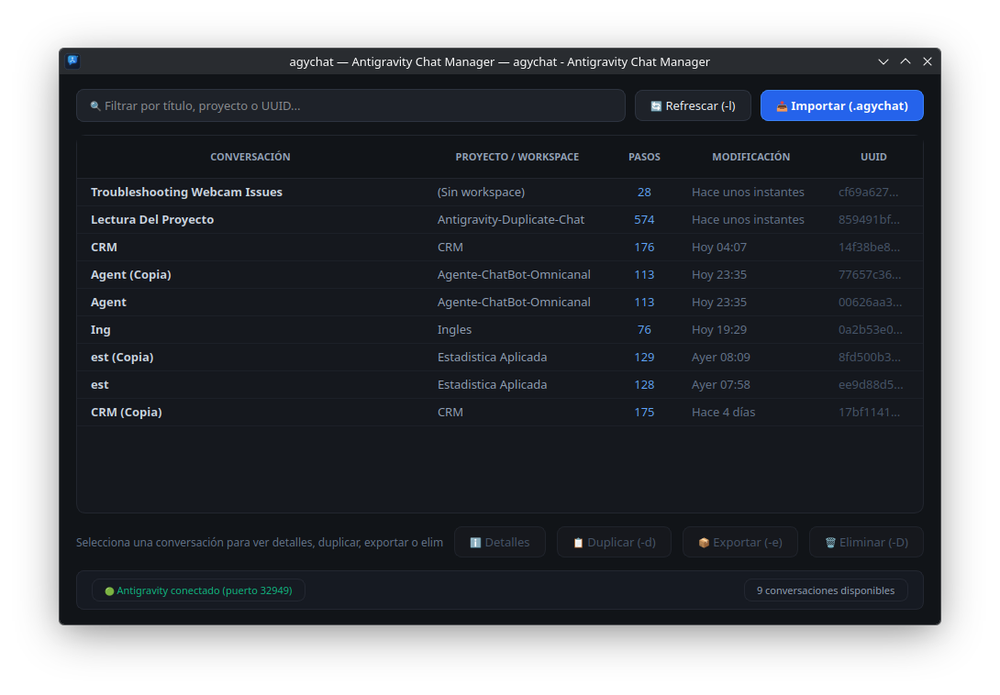

# agychat (Antigravity Chat Manager)

Herramienta de escritorio y línea de comandos para **ramificar, duplicar, exportar e importar** conversaciones en **Google Antigravity**, manteniendo el historial completo de análisis, transcripciones y artefactos sin necesidad de volver a leer ni indexar los contenidos del proyecto.

Cuenta con **interfaz de consola (CLI)** y una **aplicación de escritorio gráfica (GUI en PyQt6)** con soporte de modo oscuro, arrastrar y soltar (*drag & drop*) e integración en el gestor de tareas del sistema.

---

## 📌 Motivación

Al iniciar un chat nuevo, los asistentes de IA deben releer e indexar todo el repositorio, consumiendo una gran cantidad de tokens y tiempo. **agychat** permite duplicar, ramificar y transferir conversaciones existentes preservando todo el contexto ganado, lo que permite **ahorrar tokens**, explorar soluciones alternativas y continuar el trabajo en otra máquina sin reindexar.

---

## ✨ Características

* **Interfaz Gráfica (PyQt6):** Nativa, en modo oscuro, con buscador en tiempo real y soporte Drag & Drop.
* **Integración en el Sistema:** Lanzador `.desktop` e icono vectorial visible en el menú y gestor de tareas.
* **Duplicación en Caliente:** Ramifica chats al instante conectándose con `language_server` sin reiniciar la app.
* **Exportación Portátil:** Empaqueta historial SQLite, metadatos y artefactos en archivos `.agychat`.
* **Importación Inteligente:** Remapea rutas `$HOME`, asocia workspaces locales y resuelve colisiones de UUID.
* **Eliminación Segura:** Descarga el chat de memoria en vivo y limpia SQLite y archivos de disco.
* **Ficha de Detalles:** Muestra métricas de pasos, actividad, proyecto y desglose de espacio en disco.

---

## 🚀 Instalación

1. Clonar el repositorio y acceder a la carpeta:

```bash
git clone https://github.com/Tiago-Pujia/agychat.git
cd agychat
```

2. Otorgar permisos de ejecución y ejecutar el instalador:

```bash
chmod +x install.sh
./install.sh
```

El script se encarga automáticamente de:
* Registrar el comando **`agychat`** en `~/.local/bin` (junto con alias de compatibilidad).
* Instalar el icono vectorial en `~/.local/share/icons/hicolor/scalable/apps/agychat.svg`.
* Registrar el lanzador de escritorio en `~/.local/share/applications/agychat.desktop`.

---

## 🖥️ Interfaz Gráfica (GUI)

Puedes abrir la aplicación gráfica de dos formas:
1. **Desde la terminal:**
   ```bash
   agychat -g
   # o con la opción larga:
   agychat --gui
   ```
2. **Desde el menú de aplicaciones:** Presiona la tecla `Super` (Windows) y escribe **"agychat"**.



---

## 💻 Ejemplos de Uso en Consola (CLI)

### 1. Consultar ayuda
```bash
agychat -h
agychat --help
```

---

### 2. Listar conversaciones existentes
Para consultar los títulos y UUIDs de todos los chats registrados actualmente en Antigravity:

```bash
agychat -l
agychat --list
```

---

### 3. Duplicar una conversación (en caliente)

* **Copia automática con sufijo `(Copia)`:**
  ```bash
  agychat -d "Analisis Inicial"
  agychat --duplicate "Analisis Inicial"
  ```

* **Copia asignando un nuevo título:**
  ```bash
  agychat -d "Analisis Inicial" -t "Modulo 2 - Refactor"
  agychat --duplicate "Analisis Inicial" --title "Modulo 2 - Refactor"
  ```

> **Nota:** La búsqueda admite coincidencias parciales de título o el UUID de la conversación.

---

### 4. Exportar una conversación a un archivo portátil

Para empaquetar un chat en un archivo portátil (`.agychat`):

```bash
agychat -e "Analisis Inicial"
agychat --export "Analisis Inicial"
```
*(Generará automáticamente `Analisis_Inicial.agychat`).*

También puedes especificar el nombre o ruta del archivo de salida con `-o` o `--output`:

```bash
agychat -e "Analisis Inicial" -o ~/Descargas/mi_chat.agychat
agychat --export "Analisis Inicial" --output ~/Descargas/mi_chat.agychat
```

---

### 5. Importar una conversación en otra computadora

Una vez transferido el archivo a la otra máquina:

```bash
# Importación estándar (detecta automáticamente el workspace si el repo coincide):
agychat -i mi_chat.agychat
agychat --import mi_chat.agychat

# Importación asignando un título nuevo:
agychat -i mi_chat.agychat -t "Investigación Traída de Laptop"

# Importación vinculando a la ruta del proyecto local:
agychat -i mi_chat.agychat -w ~/Proyectos/mi-repositorio

# Forzar la generación de un nuevo UUID si hubiera conflicto:
agychat -i mi_chat.agychat --new-id

# Sobrescribir si el UUID ya existe en el sistema:
agychat -i mi_chat.agychat --overwrite
```

### 6. Eliminar una conversación

Elimina permanentemente una conversación tanto en Antigravity (descargándola de memoria) como de la base de datos y disco:

```bash
# Solicita confirmación antes de eliminar:
agychat -D "Analisis Inicial"
agychat --delete "Analisis Inicial"

# Eliminar directamente sin confirmación:
agychat -D "Analisis Inicial" -f
agychat --delete "Analisis Inicial" --force
```

---

## 📖 Referencia Completa de Banderas (Flags)

| Bandera Corta | Bandera Larga | Argumento | Descripción |
|---|---|---|---|
| `-g` | `--gui` | *(ninguno)* | Abre la aplicación de escritorio gráfica interactiva. |
| `-h` | `--help` | *(ninguno)* | Muestra la ayuda interactiva en consola. |
| `-l` | `--list` | *(ninguno)* | Lista todos los chats disponibles con su UUID. |
| `-d` | `--duplicate` | `<CHAT>` | Duplica un chat en caliente por título o ID. |
| `-e` | `--export` | `<CHAT>` | Exporta un chat a archivo `.agychat`. |
| `-i` | `--import` | `<ARCHIVO>` | Importa un chat desde archivo `.agychat`. |
| `-D` | `--delete` | `<CHAT>` | Elimina permanentemente una conversación. |
| `-f` | `--force` | *(ninguno)* | No solicita confirmación al eliminar un chat. |
| `-t` | `--title` | `<TITULO>` | Título personalizado al duplicar o importar. |
| `-o` | `--output` | `<ARCHIVO>` | Ruta del archivo de salida al exportar. |
| `-w` | `--workspace` | `<RUTA>` | Ruta del proyecto local en destino al importar. |
| | `--new-id` | *(ninguno)* | Fuerza la asignación de un nuevo UUID al importar. |
| | `--overwrite` | *(ninguno)* | Sobrescribe el chat si el UUID ya existe en destino. |

---

## 📋 Requisitos del Sistema

* **Sistema Operativo:** Linux
* **Python:** 3.8 o superior
* **PyQt6:** Para la interfaz gráfica (generalmente preinstalado o `sudo apt install python3-pyqt6` / `pip install PyQt6`).
* **Google Antigravity:** Instalado. (Para duplicación en vivo o carga inmediata al importar, debe encontrarse en ejecución; de lo contrario, la importación se registrará para el próximo inicio).

---

## 🗑️ Desinstalación

Para retirar el comando, el lanzador `.desktop`, el icono y los enlaces simbólicos del sistema:

```bash
chmod +x uninstall.sh
./uninstall.sh
```
